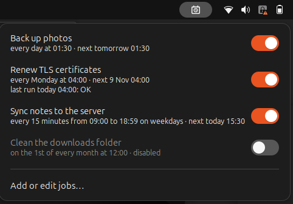
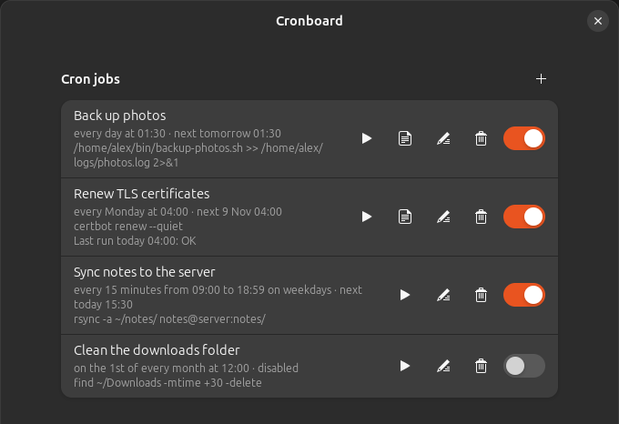

<div align="center">


# Cronboard

Manage your cron jobs from the GNOME top bar.


<br>




</div>

## Features

- See every job in your crontab with its schedule in words, such as *every weekday at 09:00*, and when it runs next
- Turn jobs on and off from the panel menu
- Add, edit and delete jobs, with presets or a raw cron expression that's checked as you type
- Run a job on demand and follow its log while it runs
- Get a red panel icon when a tracked job fails

## Install

```sh
git clone https://github.com/seniru-dilmith/cronboard.git
cd cronboard
npm install
npm run build
npm run install-dev
gnome-extensions enable cronboard@seniru-dilmith.github.io
```

Log out and back in once so GNOME Shell loads it.

## Good to know

**Your crontab stays as you wrote it.** Cronboard only rewrites the lines you edit. Comments, blank lines and variables are left alone. If the crontab changed elsewhere since Cronboard loaded it, Cronboard won't save over it. A backup of the previous version is kept in `~/.local/share/cronboard/backups/` before every save.

**Disabled jobs are commented out** with `#cronboard-disabled#` at the start of the line, and turning them back on restores the original line exactly.

**Job names** come from the comment directly above a job.

**Run now** starts the job with the same minimal environment cron uses, so you can catch problems that only happen under cron.

**Logs:** new jobs get a log file in `~/.local/state/cronboard/logs/`, named after the job, which you can change or clear. Open log shows it and keeps up with it while the job runs. Jobs that already write to a file (`>> ~/logs/backup.log 2>&1`) work the same way.

**Track runs** is optional per job. It records each run's result so the panel can show it. Tracked jobs keep working even if you remove Cronboard, but turn tracking off first if you also plan to delete `~/.local/share/cronboard`.

Only your own crontab is managed, not the root crontab or `/etc/cron.d`.

## Development

```sh
npm test          # unit tests
npm run build     # type-check and bundle into dist/
npm run nested    # try it in a nested GNOME Shell
npm run pack      # build the zip for extensions.gnome.org
```

## License

GPL-2.0-or-later
